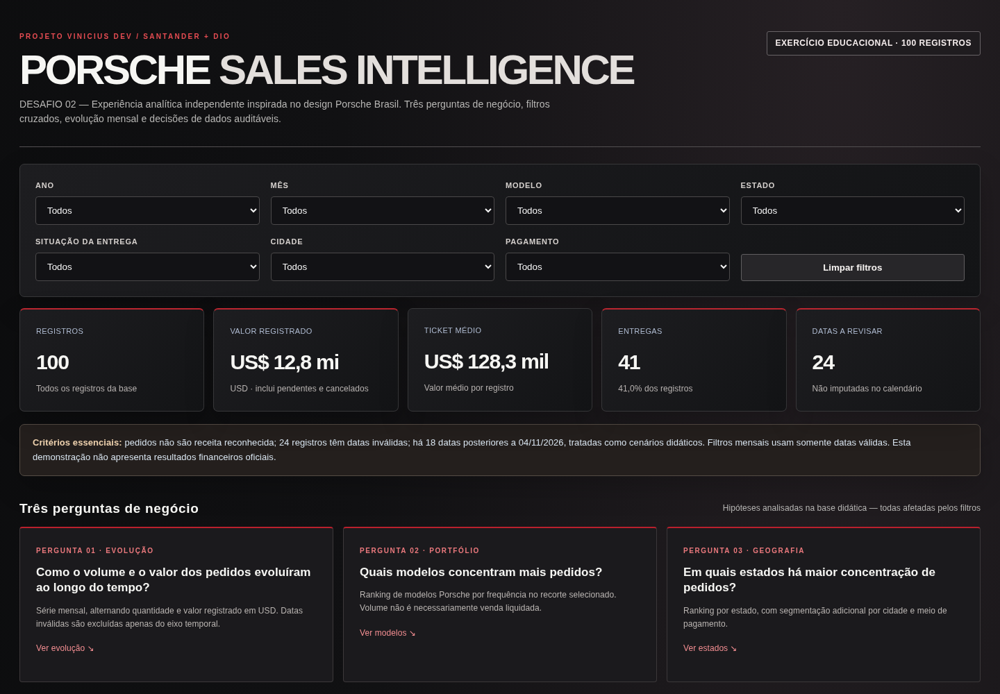
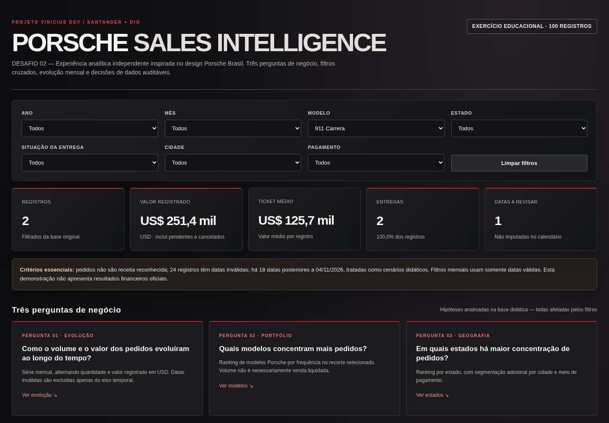

# Desafio 02 — Dashboard Porsche | Santander/DIO AI Reports

> Projeto de estudo e portfólio. Interface inspirada na Porsche Brasil, sem vínculo ou endosso da marca. Desenvolvido com assistência do ChatGPT e revisão dos requisitos e resultados.

**[Abrir dashboard interativo](https://viniciusferreirars.github.io/porsche-ai-data-review/desafio-02-dashboard/)** · [Voltar à versão anterior](https://viniciusferreirars.github.io/porsche-ai-data-review/)

## Três perguntas de negócio

| Pergunta | Justificativa | Indicador/gráfico |
|---|---|---|
| **1. Como os pedidos evoluem por mês?** | Entender variações temporais de volume e valor registrado. | Série evolutiva em barras e linha, com alternância volume/valor e comparação entre meses. |
| **2. Quais modelos concentram mais pedidos?** | Compreender a composição do portfólio de veículos. | Ranking dos modelos mais frequentes. |
| **3. Onde estão concentrados os pedidos?** | Identificar concentração geográfica e segmentar por mercado. | Ranking de estados e filtros por cidade. |

## Evolução de UI/UX — da primeira à segunda versão

A primeira versão priorizou a **exploração dos dados**, a qualidade da base e a apresentação detalhada dos indicadores. Na segunda, o objetivo foi **adaptar a interface à leitura executiva e à referência visual da Porsche Brasil**, com estética mais minimalista, elegante e refinada: preto, grafite, alto contraste e destaques discretos em vermelho. Essa evolução atende aos requisitos do segundo desafio e demonstra como uma solução analítica pode mudar conforme o público e os objetivos de negócio, preservando suas funcionalidades.

**O que mudou na prática:** três perguntas de negócio passaram a orientar a leitura do painel; acrescentamos filtros por cidade e meio de pagamento; a evolução mensal ganhou destaque; e o layout foi reorganizado para uma apresentação mais sóbria. **A versão 1 permanece disponível**, permitindo comparar as escolhas de UI/UX.

## Funcionalidades

- HTML **único**, com CSS, JavaScript e dados tratados incorporados, sem dependências externas.
- **Big Cards**: quantidade, valor registrado em USD, ticket médio por pedido, entregas e datas a revisar.
- Filtros por **ano, mês, modelo, estado, cidade, forma de pagamento e status de entrega**.
- Visualização evolutiva com barras e linha; tabela mensal e insights descritivos.
- Botão de limpar filtros, layout responsivo e seção opcional de custos das ferramentas do projeto.

## O prompt e os refinamentos

O desenvolvimento ocorreu com apoio do **ChatGPT** para elaboração e revisão do código, partindo dos requisitos definidos pelo aluno. **Não foi usado Canvas nem agente persistente com skill específica.** O script Python anterior é uma transformação determinística baseada no `schema.md`, não um agente autônomo.

**Briefing inicial — resumo fiel, não transcrição literal de uma única mensagem:** construir uma dashboard de vendas Porsche, com qualidade dos dados, proteção de informações pessoais, filtros, Big Cards, gráficos e publicação no GitHub Pages.

### Prompt consolidado para reprodução (reconstruído)

O texto abaixo é um **prompt consolidado reconstruído a partir do enunciado e das orientações dadas ao longo do desenvolvimento**; não é uma cópia literal de uma única mensagem histórica nem um registro de execução automatizada.

```text
Atue como especialista em engenharia de dados, desenvolvimento front-end e UI/UX.
Crie um dashboard executivo sobre vendas/pedidos Porsche usando a planilha
tratada do exercício Santander/DIO. A entrega deve ser um único arquivo
index.html, contendo HTML, CSS, JavaScript e dados públicos tratados,
executável localmente e publicável no GitHub Pages, sem backend ou dependências
externas obrigatórias.

Responda visivelmente a três perguntas de negócio:
1. Como o volume e o valor registrado dos pedidos evoluem por mês?
2. Quais modelos concentram mais pedidos?
3. Em quais estados se concentram os pedidos?

Inclua KPIs no topo (registros, valor registrado em USD, ticket médio,
entregas e problemas de qualidade) e filtros combináveis por ano, mês,
modelo, estado, cidade, método de pagamento e status de entrega.
Mostre evolução temporal, rankings, status e insights. Os indicadores,
gráficos e tabelas devem reagir aos filtros e oferecer botão de limpeza.

Use uma identidade visual elegante, sóbria e responsiva, inspirada na
linguagem de design da Porsche Brasil: fundo preto/grafite, tipografia
sans-serif, alto contraste e acentos vermelhos discretos. Não reproduza
logotipos, imagens nem fontes proprietárias.

Respeite os cuidados de privacidade/LGPD: não inclua nomes de clientes,
vendedores ou identificadores de origem na página. Preserve os 100
registros tratados, destaque datas inválidas e datas futuras didáticas.
Não invente datas ou resultados e deixe claro que valor registrado de
pedidos não é lucro nem receita reconhecida.

Forneça README documentando perguntas e razões, tratamento anterior,
uso transparente da IA, evolução do prompt, links de publicação e
capturas de tela com e sem filtros.
```

**Trajetória das alterações:** o primeiro briefing priorizava qualidade e exploração dos dados; o segundo enunciado exigiu três perguntas de negócio visíveis, indicadores de topo e um HTML único. Depois incorporamos **cidade e método de pagamento**, gráfico mensal com alternância entre quantidade e valor, design executivo inspirado na referência fornecida e evidências com filtros aplicados. As alterações foram revisadas no código e documentadas, sem alegar uso de Canvas ou de agente LLM autônomo.

**Refinamentos da Parte 2:**
1. Explicitar **três perguntas de negócio**, com gráficos correspondentes e justificativas.
2. Incluir filtros de **cidade e pagamento** nos filtros já existentes.
3. Melhorar o gráfico temporal com **linha evolutiva e alternância de métricas**.
4. Revisar **UI/UX**: fundo preto/grafite, tipografia sans-serif, alto contraste e acentos vermelhos discretos, inspirados na linguagem visual do [site Porsche Brasil](https://www.porsche.com/brazil/pt/), sem copiar logotipos, imagens ou fontes proprietárias.
5. Testar filtros combinados, reinicialização e indicadores.

## Tratamento anterior à visualização

A base de entrada é `planilha_porsche_tratada.xlsx`, gerada no primeiro desafio, com **100 registros**. O processo está documentado em [`schema.md`](../schema.md), [`data_review.md`](../data_review.md) e [`pipeline_tratamento.py`](../pipeline_tratamento.py).

- **24 datas inválidas** ficam sinalizadas, sem inventar substituições, e são excluídas da série mensal.
- **18 datas posteriores à data de referência do exercício (04/11/2026)** permanecem marcadas como dados didáticos; não são previsões.
- Preços, quilometragens e categorias foram padronizados.
- Nomes pessoais e identificadores comerciais originais não aparecem na visualização; a pseudonimização não equivale necessariamente à anonimização total.
- **Valor registrado não é faturamento reconhecido ou lucro:** há pedidos cancelados e pendentes.
- Os registros se referem a **estados e cidades dos EUA**. Porsche Brasil é apenas uma **referência estética**.

## Evidências e publicação

- **Dashboard:** https://viniciusferreirars.github.io/porsche-ai-data-review/desafio-02-dashboard/
- **Código:** `index.html` nesta pasta.
### Evidência 1 — Visão geral do dashboard



### Evidência 2 — Filtros aplicados



As duas capturas demonstram a tela inicial e a atualização da visualização a partir de um recorte nos dados.

## Execução

Abra `index.html` diretamente no navegador. Não há backend ou dependências obrigatórias. Para reproduzir o tratamento a partir dos dados brutos, use o pipeline no repositório principal **localmente**, sem publicar arquivos com dados pessoais.

---

**Créditos:** exercício da aceleração Santander/DIO — AI Reports com Excel, GPT Agents e Claude Code. Portfólio independente do Projeto Vinicius Dev.